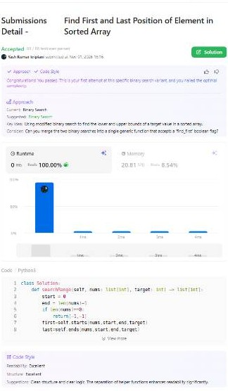

# Data Structures, Algorithms & OOP Foundations 🚀

A meticulously documented repository tracking my core computer science foundations, algorithmic optimization milestones, and Object-Oriented Programming implementations in Python. This codebase serves as a primary technical asset for my Google STEP Internship preparation strategy.

## 📁 Repository Architecture

*   📁 **`Searching_Algorithms/`**
    *   📄 `linear_and_binary_search.ipynb`: A comprehensive master notebook containing algorithm explanations, edge-case traces (tiny, duplicate, and empty arrays), execution boundary reviews, and strict $\mathcal{O}(\log N)$ binary partitioning solutions.
    *   📷 `leetcode_proof.png`: Verified visual execution proof of production-grade solution metrics.
*   📁 **`Object_Oriented_Programming/`**
    *   📄 `02_OOP_Basics.ipynb`: **[Complete]** Detailed architectural logs tracking class instantiation states, constructor initialization mechanics (`__init__`), instance variable binding (`self`), memory allocation layouts, and the 4 primary pillars of OOP design.

## 🎯 Key Milestones Achieved

*   **LeetCode #34 (Find First and Last Position of Element in Sorted Array):** Engineered an optimal double-binary search architecture that achieved a **0 ms execution runtime, beating 100.00% of global Python3 submissions** via strict logarithmic boundary partitioning.
    
    ### 📊 LeetCode Verification Proof:
    

*   **Complexity Optimization Matrix:** Successfully isolated and eliminated linear neighbor scanning traps ($\mathcal{O}(N)$ algorithmic decay vulnerabilities) within duplicate blocks, refactoring code cells using a decoupled tracking register pattern to preserve an absolute $\mathcal{O}(\log N)$ worst-case performance threshold.

*   **Object-Oriented Architecture Paradigm:** Deconstructed the core object execution principles including **Encapsulation, Inheritance, Polymorphism, and Abstraction**. Formulated custom mock models (e.g., Network Packet and Blockchain Block architectures) to act as a direct syntactic bridge toward managing low-level dynamic memory layouts in advanced data structures.

---
*Maintained with pride by a B.Tech CSE Hons (Cybersecurity & Blockchain) Student at LPU, integrated with CompTIA technical pathways.*
